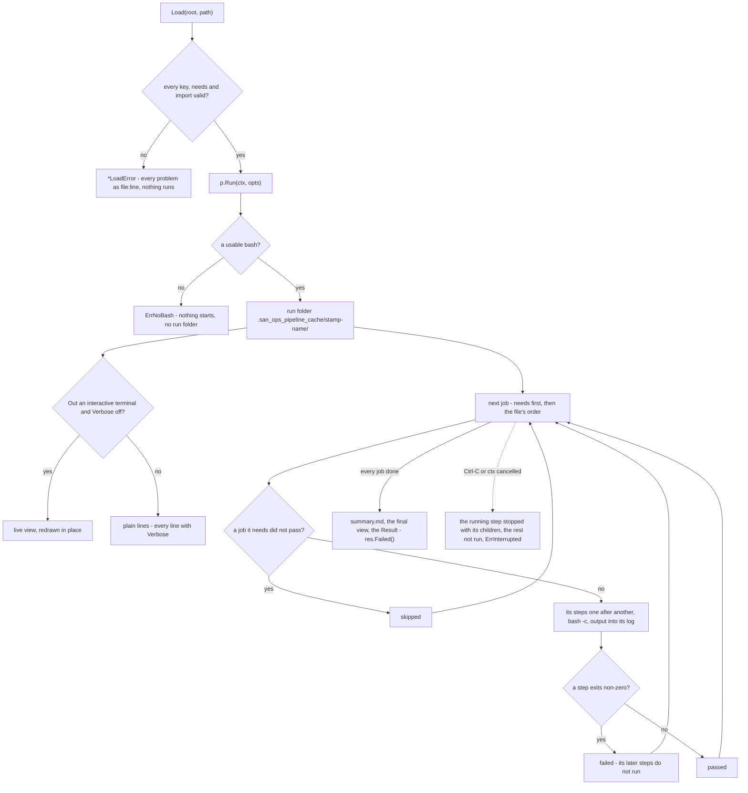

# san_ops_pipeline

Our own CI/CD for pdcgo projects: a Go library that runs pipelines written as small YAML files.

```
go get github.com/pdcgo/san_ops_pipeline
```

A pipeline file uses GitHub Actions' words — `jobs`, `steps`, `run`, `needs`, `env`, `uses` — but it is **not**
compatible with GitHub Actions: no `${{ }}` expressions, no marketplace actions, no containers. The library knows
nothing about the repo it runs in; everything a pipeline does is a shell command. No database: each run writes a
folder of logs.

The design and every decision behind it: warehouse_revamp,
`docs/technical/packages/san_ops_pipeline/context_decision.md`.

Dependencies: `gopkg.in/yaml.v3` (the file, with its line numbers), `golang.org/x/sys` (Windows job objects and the
console mode) and `golang.org/x/term` (is `Out` a terminal, how wide) — no TUI framework.

## Usage

```go
p, err := san_ops_pipeline.Load(".", "pipeline/slice.yaml") // root, file
if err != nil {
	log.Fatal(err) // every problem of the file and its imports, each as file:line
}

res, err := p.Run(ctx, san_ops_pipeline.RunOptions{Out: os.Stdout}) // a live view on a terminal
if err != nil {
	log.Fatal(err) // no bash, a run folder that cannot be written, or interrupted
}

if res.Failed() {
	os.Exit(1) // a red pipeline is a result, not an error
}
```

The exported functions, each with its own `Example…` in `example_test.go` (`ExampleLoad`, `ExampleLoadError_Error`,
`ExampleProblem_String`, `ExamplePipeline_Run`, `ExampleResult_Failed`, plus `ExampleLoadError`; the two that run bash
compile but do not run):

### `Load`

`Load(root, path string) (*Pipeline, error)` reads the pipeline file `path` and every file its jobs import, and
checks all of it before anything can run. `root` is the folder every path is read from: `path` itself when relative,
each `uses:` (an imported file's own `uses:` too) and each `dir:`; the steps start in it and the run folder is
written under it. For revamp it is the repo root.

```go
p, err := san_ops_pipeline.Load("D:/pdcgo/warehouse_revamp", "pipeline/slice.yaml")
for _, j := range p.Jobs { // in the file's order
	fmt.Println(j.Name, j.Needs, len(j.Steps), j.Uses)
}
```

The result is a `*Pipeline` (`Name`, `File`, `Env`, `Jobs`); each `*Job` has `Name`, `Needs`, `Env` and either
`Steps` (`Run`, `Dir`, `Env`) or `Uses` with the loaded `Import`. A pipeline is never changed by a run, so it can run
again.

### `LoadError.Error`

A refused file returns a `*LoadError` whose `Problems` list **every** problem found, in file order — not just the
first. `Error()` writes a single problem as its `file:line: msg`, several as a count with one problem per line:

```go
_, err := san_ops_pipeline.Load("testdata", "refused/needs.yaml")
fmt.Println(err)
// 3 problems in the pipeline files:
//   refused/needs.yaml:6: job "b" needs "ghost", which is not a job in this file
//   refused/needs.yaml:9: needs loop: a → c → a (each needs the next) — these jobs can never start
//   refused/needs.yaml:12: needs loop: d → d (each needs the next) — these jobs can never start
```

### `Problem.String`

Each `Problem` has `File` (relative to the root), `Line` (from the YAML, 0 for the file as a whole) and `Msg`;
`String()` writes `file:line: msg`, or `file: msg` without a line — the form editors and CI logs link to:

```go
var refused *san_ops_pipeline.LoadError
if errors.As(err, &refused) {
	for _, p := range refused.Problems {
		fmt.Println(p.String()) // refused/needs.yaml:6: job "b" needs "ghost", which is not a job in this file
	}
}
```

### `Pipeline.Run`

`p.Run(ctx, RunOptions{Out, Verbose}) (*Result, error)` runs the pipeline (how: [How a run goes](#how-a-run-goes);
what it shows: [What the terminal shows](#what-the-terminal-shows)).

```go
res, err := p.Run(ctx, san_ops_pipeline.RunOptions{
	Out:     os.Stdout, // a terminal: the live view; a pipe or file: plain lines; nil: nothing
	Verbose: false,     // true: plain lines with every line the steps print, [job] in front
})
```

`err` is only for a run that could not happen or was cut short: `ErrNoBash` (before anything starts), a run folder
or log that cannot be written, or `ErrInterrupted` (Ctrl-C or a cancelled `ctx` — the `Result` comes back too).

### `Result.Failed`

`res.Failed()` is true when the run did not pass: a job failed, or it was interrupted (a nil `Result` counts as
failed). `Result` holds the run folder (`Dir`), `Status` (`Passed`, `Failed`, `Interrupted`), `Started`, `Took` and
each job's `JobResult`: `Status` (`Passed` / `Failed` / `Skipped` / `Interrupted` / `NotRun`), `Took`, `Log` (relative
to `Dir`), and for a failed job the `Step`, its `Command` and `Exit` code (or the `Reason` it could not start); a
skipped job's `Needs`; an imported job's own `Jobs`.

```go
if res.Failed() {
	for _, j := range res.Jobs {
		if j.Status == san_ops_pipeline.Failed {
			fmt.Printf("%s: step %d exited %d, log %s\n", j.Name, j.Step, j.Exit, filepath.Join(res.Dir, j.Log))
		}
	}
}
```

## The file format

```yaml
name: slice                     # optional; default: the file's name without .yaml
env:                            # optional, for every job
  CGO_ENABLED: "0"
jobs:                           # required; run in this order where `needs` leaves it open
  checks:
    uses: pipeline/checks.yaml  # this whole file runs as the one job "checks"
  go-tests:
    needs: [checks]             # a name or a list of names of this file's jobs
    env:
      GOFLAGS: -count=1
    steps:
      - run: go test ./backend/...
  stories:
    needs: checks
    steps:
      - run: |                  # several lines are one bash script
          npm ci
          npm run test:stories
        dir: frontend           # read from the root
        env:
          CI: "1"
```

| Where | Key | What |
| --- | --- | --- |
| file | `name` | the pipeline's name (shown, and in the run folder's name) |
| file, job, step | `env` | `NAME: value` pairs; a value is taken as text (`1` → `"1"`), never expanded |
| file | `jobs` | the jobs, a mapping of name → job; their order in the file is kept |
| job | `needs` | the jobs of the same file this one waits for |
| job | `steps` | a list of steps — or, instead, |
| job | `uses` | a pipeline file (read from the root) that runs as this one job |
| step | `run` | the command, run with `bash -c` |
| step | `dir` | the folder the command starts in, read from the root (default: the root) |

Anything else is refused, naming the key and its line — `if:`, `with:`, `timeout-minutes:`, `continue-on-error:`,
`runs-on:`, `shell:` included (not in this build). `Load` also refuses, each with its file and line:

- a job with both `steps:` and `uses:`, or with neither; an empty `steps:` list; a step without `run:` or with an
  empty one;
- a `needs` naming a job the file does not have; a `needs` loop (`a → c → a`), naming its jobs;
- an import loop (`a.yaml → b.yaml → a.yaml`), naming every file in it; an imported file that cannot be read — and
  every problem inside an imported file, with that file's own line;
- a key written twice; a value where a list or mapping belongs (and the other way round); an `env` value left empty;
- *(build choices)* a job name that is not letters, digits, `-` and `_` starting with a letter or `_` (GitHub's rule
  for job ids — it also keeps `<job>.log` a safe file name), two job names that differ only in upper/lower case (one
  log file on Windows), an `env` name bash cannot read as `$NAME`, two `env` names that differ only in case;
- an empty file, a file that is not YAML (with the parser's line), more than one YAML document in a file.

A YAML alias (`*name`) is followed; a merge key (`<<:`) is refused like any unknown key.

## How a run goes



- **One job at a time.** A job starts once every job it `needs` has finished; where `needs` leaves the order open,
  the file's order decides. The steps of a job run one after another, as written.
- **The failure rule.** A failing step — non-zero exit, or a step that cannot start (its `dir:` missing) — fails its
  job; the job's later steps do not run (its log says *not run*). Every job that needs it, directly or through other
  jobs, is **skipped**. Every other job still runs. The run then ends **failed** — a `Result` whose `Failed()` is
  true, not a Go error.
- **An imported job** (`uses:`) runs the imported file's jobs by the same rules, inside its one job; its job names
  stay its own, so they never clash with the importing file's. It fails when any of its own jobs fails. A later job
  waits for the whole import with `needs: [<the job's name>]`.
- **Environment.** Each step runs in the caller's environment plus the `env:` values — the pipeline's, then the job's,
  then the step's, the inner one winning. *(Build choice.)* A `uses:` job passes its layers on: the imported file sees
  the importing pipeline's and the importing job's `env`, and its own pipeline, job and step `env` go on top (the
  imported file's values win). On Windows names match without regard to case (`Path` is `PATH`).
- **Interrupt.** Ctrl-C (Run catches it while it runs, and gives it back when it returns) or a cancelled `ctx` stops
  the running step together with every process it started, starts nothing more, and marks that job *interrupted*, the
  jobs not reached *not run*; `summary.md` says *INTERRUPTED*, and `Run` returns the `Result` with `ErrInterrupted`
  (which also wraps the context's cause, e.g. `context.Canceled`).
- *(Build choice.)* **Nothing outlives its step.** When a step's bash exits, whatever it left running in the background
  (`server &`) is stopped too. A step that needs a server starts and stops it inside the same `run:`.
- *(Build choice.)* A step gets no input: its stdin is the null device. Its stdout and stderr both go to the job's log.
- Nothing is left running when `Run` returns: no goroutine (proved by a test counting them, live view included) and
  no process; a Windows console mode changed for the live view is back as it was.

### Which bash

Every `run:` is `bash -c '<run>'`.

- **Linux and macOS:** the `bash` on `PATH`.
- **Windows:** Git for Windows' bash, never `C:\Windows\System32\bash.exe` or `…\WindowsApps\bash.exe` — those are WSL
  launchers that run the command inside Linux. It is found from `git` on `PATH` (`<Git>\cmd\git.exe`,
  `<Git>\bin\git.exe` or `<Git>\mingw64\bin\git.exe` → `<Git>\bin\bash.exe`), else from a `bash.exe` on `PATH` outside
  System32 and WindowsApps. None found → `Run` returns `ErrNoBash` before anything starts.

The command reaches bash unchanged, quotes and backslashes included (on Windows the command line is written for the
MSYS runtime's own parsing rules, which Go's default quoting does not match).

### How a step is stopped

- **Linux / macOS:** the step runs in a process group of its own; stopping it kills the whole group
  (`kill(-pgid, SIGKILL)`). The group is not the terminal's foreground group, so a Ctrl-C reaches only the caller.
- **Windows:** the step starts suspended, joins a *job object*, and only then runs, so every process it starts is in
  the job; stopping it terminates the job — bash, `go test` and its test binary, a background child whose parent has
  already exited. The job also kills them if the calling program dies. If Windows refuses the job, `taskkill /T /F`
  stands in.
- Stopping is immediate (`SIGKILL` / terminate) — *(build choice)* no grace period.

## The run folder

Every run writes `<root>/.san_ops_pipeline_cache/<stamp>-<name>/`: the stamp is local time `20060102-150405` (as
`san test` stamps its runs), the name is the pipeline's, made folder-safe (letters, digits, `.`, `_`, `-`; anything
else becomes `-`). Two runs in the same second get `-2`, `-3`, … after the name.

```
.san_ops_pipeline_cache/
  .gitignore                      # "*" — written when the library makes the folder; no repo has to list it
  20261121-143005-slice/
    summary.md
    go-tests.log                  # one log per job: every step's full output
    stories.log
    checks/                       # an imported job: its file's own jobs
      build.log
      vet.log
```

A job log has a header line per step (its number, start time and `dir`), the command (`$ …` lines), the step's
output, and a closing line with the exit code and time:

```
── step 1/1 · started 2026-11-21 13:36:25
$ go test ./backend/...
--- FAIL: TestRestockAccept (0.42s)
    restock_accept_test.go:88: want 3 units, got 2
── step 1/1 · exit 1 · 5m38s
```

`summary.md` — the pipeline, its result, each job passed / failed / skipped with its time and log, imported jobs
nested:

```markdown
# pipeline slice — FAILED

- file: `pipeline/slice.yaml`
- started: 2026-11-21 13:36:25
- took: 13m58s

## Jobs

- ✓ **checks** · passed · 1m02s · uses `pipeline/checks.yaml`
  - ✓ **build** · passed · 0m40s · [checks/build.log](checks/build.log)
  - ✓ **vet** · passed · 0m22s · [checks/vet.log](checks/vet.log)
- ✗ **go-tests** · failed · 5m38s · step 1 `go test ./backend/...` exit 1 · [go-tests.log](go-tests.log)
- ✓ **stories** · passed · 7m15s · [stories.log](stories.log)
- ⏭ **e2e** · skipped (needs go-tests)
```

Old run folders are never removed by the library.

## What the terminal shows

`RunOptions.Out` picks how a run is shown. The full output of every step is always in its job's log, whatever is
shown.

| `Out` | Shown |
| --- | --- |
| an interactive terminal (`os.Stdout` in cmd, PowerShell, Windows Terminal, a Linux or macOS shell) | the **live view**, redrawn in place |
| anything else — a pipe, a file, a buffer, cron, a bot's shell, Git Bash's own mintty window (it gives programs a pipe) | **plain lines** |
| either, with `Verbose: true` | plain lines with **every** output line |
| `nil` | nothing (the logs and `summary.md` are written either way) |

The live view is chosen only when `Out` is an `*os.File` that `golang.org/x/term` calls a terminal — and
*(build choice)* `TERM` is not `dumb`. On Windows the console reads escape codes only once its
`ENABLE_VIRTUAL_TERMINAL_PROCESSING` mode is on: the run turns it on (through `golang.org/x/sys/windows`) when it is
off and puts the console's mode back when `Run` returns; a console that refuses (before Windows 10) gets plain lines.

### The live view

While the run goes, every job is shown with its status — ✓ passed, ✗ failed or stopped, ⏭ skipped, ● running,
· waiting — and its time; the running job's timer ticks, and the running step's last **5** output lines are shown
under it. An imported file's jobs are shown indented under the job that imports it, from the start:

```
pipeline slice · 20261121-143005-slice     6m40s
  ✓ checks     uses pipeline/checks.yaml   1m02s
    ✓ build   go build ./...               0m40s
    ✓ vet     go vet ./...                 0m22s
  ● go-tests   go test ./backend/...       5m38s
      ok   …/order_service/order_v1        41.2s
      ok   …/inventory_service/inventory_v1 58.7s
      === RUN   TestRestockAccept
  · stories    waiting
  · e2e        waiting (needs go-tests)
```

When the run ends, the view is replaced by the summary, the last **20** lines of the step that failed, and the run
folder:

```
pipeline slice · FAILED in 13m58s
  ✓ checks     1m02s
    ✓ build   0m40s
    ✓ vet     0m22s
  ✗ go-tests   5m38s   go test ./backend/... (exit 1)
  ✓ stories    7m15s
  ⏭ e2e        skipped (needs go-tests)

go-tests · last lines of go-tests.log
  --- FAIL: TestRestockAccept (0.42s)
      restock_accept_test.go:88: want 3 units, got 2
logs: .san_ops_pipeline_cache/20261121-143005-slice/
```

These are the record's mocks as the code draws them (`TestLiveViewDrawsTheRecordsMocks` renders exactly these).

- **Redraws.** The view is redrawn when a job or a step starts or ends, and by the ticking timer while a step runs —
  at most once a second. Output lines alone never redraw. The redraw is plain escape codes (cursor up, erase line,
  erase below), written in one go; no TUI framework.
- **Width.** Every line of a redraw is cut to the terminal's width less one column (with `…`), so a redraw never
  wraps; the width is read again before each redraw, so a resized window is followed. A step's own escape codes
  (colours, cursor moves) and control characters are taken out of the lines shown, tabs become spaces, and a line
  rewritten with `\r` (a progress bar) shows what a terminal would show — the text after the last `\r`.
- **Height.** *(Build choice.)* A frame taller than the terminal cannot be redrawn in place, so the header stays and
  the rest keeps the running job and its lines in sight, with `… n more above` / `… n more below` for the lines left
  out.
- **What a line says.** *(Build choices.)* A running job with several steps shows `2/3 · <command>`; a passed job its
  one command, `<n> steps`, or what it imports; a failed one its command and exit code (`(exit 1)`), why it could not
  start, or — for an imported job — which of its own jobs failed; a waiting job the jobs it still waits for. No
  colours: the symbols carry the status.
- **The end.** *(Build choices.)* The final summary is printed once and then scrolls like any output, so it is not cut
  to the width. It lists the last lines of every step that failed or was stopped (more than one job can fail, as the
  others still run), each under its own `<job> · last lines of <log>` heading.
- While a live run draws, nothing else should write to the same terminal — another line printed in between is
  overwritten or pushes the frame out of place. A program that also logs should log to a file, or pass `Verbose`.
- Ctrl-C ends the live view cleanly: the run stops (see *Interrupt* above), the summary says *INTERRUPTED after…*,
  and the console mode is put back.

### Plain lines

Anything that is not an interactive terminal gets plain lines: one as a job starts, one as it ends (time, exit code,
log), the failing step's last 20 lines, a `still running <n>m` line every 5 minutes of a long step, and a final line
with the result and the run folder. An imported file's jobs are indented under the job that imports it.

```
pipeline slice · 20261121-133625-slice
→ checks    uses pipeline/checks.yaml
  → build  go build ./...
  ✓ build  0m40s · checks/build.log
  → vet    go vet ./...
  ✓ vet    0m22s · checks/vet.log
✓ checks    1m02s
→ go-tests  go test ./backend/...
✗ go-tests  5m38s  exit 1 · go-tests.log
    --- FAIL: TestRestockAccept (0.42s)
        restock_accept_test.go:88: want 3 units, got 2
→ stories   npm ci …
✓ stories   7m15s · stories.log
⏭ e2e       skipped (needs go-tests)
FAILED in 13m58s · logs: .san_ops_pipeline_cache/20261121-133625-slice/
```

### `Verbose`

`Verbose: true` prints plain lines — in a terminal too, instead of the live view — and every line the steps print,
each with its job in front (`[go-tests] ok …`, `[checks/vet] …`), and each step's command
(`[go-tests] $ go test ./backend/...`); the last-lines block after a failure is then left out, as those lines were just
printed.

## Errors

| Error | When |
| --- | --- |
| `*LoadError` | `Load` refused the file or an import — every problem, `file:line: msg` |
| plain error from `Load` | the root does not exist or is not a folder |
| `ErrNoBash` | no usable bash; nothing started, no run folder made |
| plain error from `Run` | the run folder or a log cannot be written (no `Result` when the folder itself fails) |
| `ErrInterrupted` | Ctrl-C or a cancelled `ctx`; the `Result` comes back too; wraps the context's cause |

A pipeline whose step failed is **not** an error: `err` is nil and `res.Failed()` is true. The terminal adds no
error: an `Out` that cannot show the live view gets plain lines, and a broken `Out` (a closed pipe) is ignored — the
logs and `summary.md` still hold everything.

## Not in scope (yet)

`with:` inputs to an imported file, `if:` conditions, timeouts, `continue-on-error`, parallel jobs, `${{ }}`
expressions, steps other than `run:`, cleaning old run folders, colours in the live view, following a window that is
made narrower while lines already wrapped, and the `san pipeline run` command (it comes after the library).

## Testing

From inside this folder (revamp's root `./...` never enters it):

```
gofmt -l .
go vet ./...
go test ./... -race -count=3
```

The tests run real `bash -c` commands (echo, exit codes, sleep, a background child that keeps writing a heartbeat
file — to prove a stop takes the whole process tree) on small pipelines from `testdata/`, each copied into a
`t.TempDir()` root. On Windows they need Git for Windows.

No test needs a real console. The live view is tested as rendering — a run's events in, the screen out, compared with
golden text — through a fake terminal (`vtscreen_test.go`) that reads the escape codes back into a screen and fails on
any line that would wrap, on a screen of a given height too; a real `Run` draws on a file the tests call a terminal
through an injected seam (`termSys`), which also stands in for the Windows console mode, so the tests prove the live
view is never chosen for a pipe, a buffer or a nil `Out`, and that the console mode is put back after the run.

The unix code (process groups, Ctrl-C as SIGINT) is tested on Linux by cross-compiling the test binary and running it
in a container with bash:

```
CGO_ENABLED=0 GOOS=linux go test -c -o sop.test .
docker run --rm -v "$PWD:/src:ro" -v "<dir of sop.test>:/t:ro" -w /src <an image with bash> \
  bash -c 'cp /t/sop.test /tmp && /tmp/sop.test -test.count=3'
```
